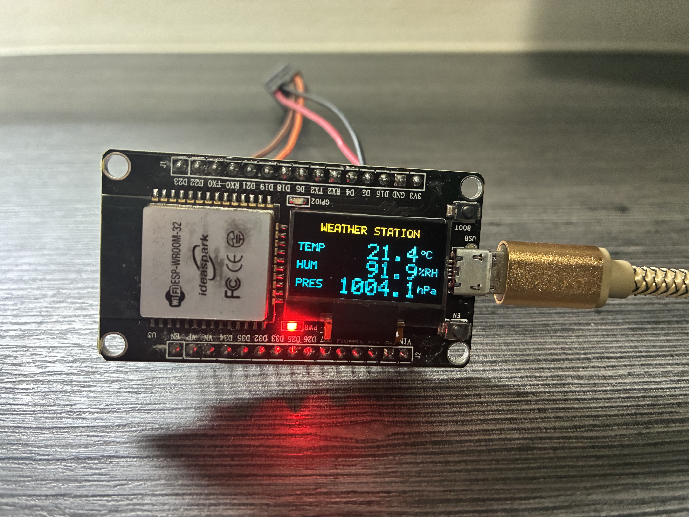

# ESP32 Weather Station

An ESP32 weather station that reads **temperature**, **humidity** and **air pressure** from a BME280 sensor and shows the values in real time on the 0.96" SSD1306 OLED display built into the ideaspark ESP32 development board.

Written in C++ with **ESP-IDF v6.1** and **FreeRTOS**, with no external libraries: the BME280 and SSD1306 drivers are implemented directly on top of the ESP-IDF I2C driver.

<p align="center">
  
</p>

## Hardware

| Component | Description |
|---|---|
| Board | ideaspark ESP32 development board with built-in 0.96" SSD1306 OLED (128x64, I2C) |
| Module | ESP-WROOM-32 (ESP32, Wi-Fi + Bluetooth) |
| Sensor | BME280 (temperature, humidity, pressure), I2C |
| Power supply | 3.3 V |

### Wiring

The BME280 shares the I2C bus with the board's display:

| BME280 | ESP32 |
|---|---|
| VCC | 3V3 |
| GND | GND |
| SDA | GPIO 21 |
| SCL | GPIO 22 |

Default I2C addresses: BME280 at `0x76` (SDO to GND; use `0x77` if SDO is tied to VCC) and SSD1306 at `0x3C`. The full board pinout is in [pinout.png](pinout.png).

The board's blue LED (GPIO 2) blinks when the system enters error mode.

## Building and flashing

Prerequisite: [ESP-IDF v6.1](https://docs.espressif.com/projects/esp-idf/) installed.

```bash
# 1. Activate the ESP-IDF environment
source ~/.espressif/tools/activate_idf_v6.1.sh

# 2. Set the target (first time only)
idf.py set-target esp32

# 3. Build
idf.py build

# 4. Flash and open the serial monitor (adjust the port)
idf.py -p /dev/ttyUSB0 flash monitor
```

The serial monitor runs at 115200 baud and prints the readings, for example:

```
I (1234) weather: T=23.41 C  H=56.12 %RH  P=1012.84 hPa  Alt~3 m
```

## Configuration

All tunable parameters live in [main/config.h](main/config.h):

- I2C pins, frequency and port;
- BME280 and SSD1306 addresses;
- display size (128x64 or 128x32), contrast and yellow band;
- sea-level pressure used for the altitude estimate;
- task periods, stack sizes and priorities.

## Architecture

The firmware runs two FreeRTOS tasks:

- **`taskMeasure`**: reads the BME280 every 2 s.
- **`taskDisplay`**: refreshes the display every 1 s.

The `i2cMutex` mutex controls access to the I2C bus, and `dataMutex` protects the data shared between the tasks. After 3 consecutive failures, the device is re-initialized automatically. If the display or the sensor fails to start at boot, the system halts and signals the error through the LED and the serial console.

```
main/
├── main.cpp      # app_main, initialization and FreeRTOS tasks
├── config.h      # central configuration
├── bme280.*      # BME280 driver (Bosch compensation formulas)
├── ssd1306.*     # SSD1306 driver with a local frame buffer
└── font5x7.h     # 5x7 font (ASCII + degree sign)
```

The full functional specification is in [esp32-weather-station.md](esp32-weather-station.md).

## Roadmap

- Send data over Wi-Fi to a server or cloud service
- Log history to an SD card or the internal flash
- Local web server to view the readings
- Sensor calibration
- Real-time clock (RTC) to timestamp the data
