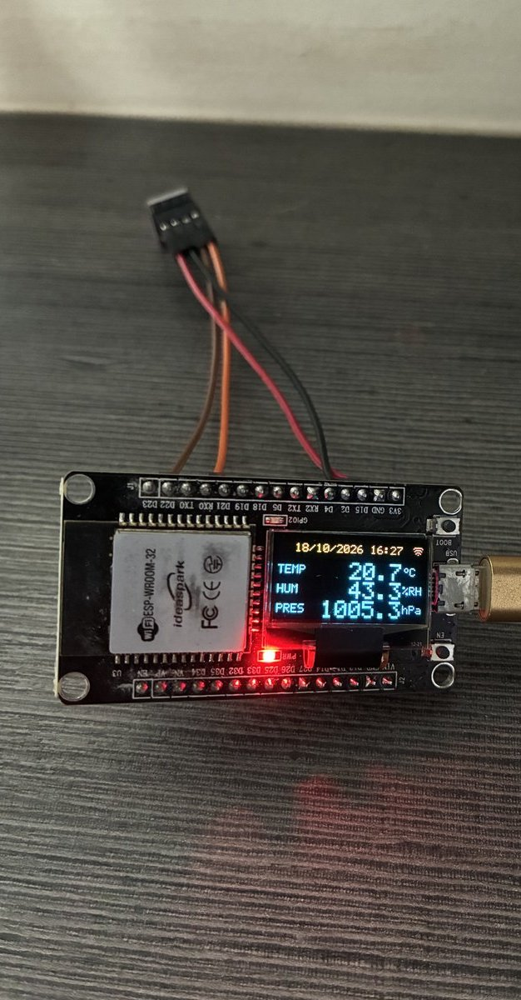
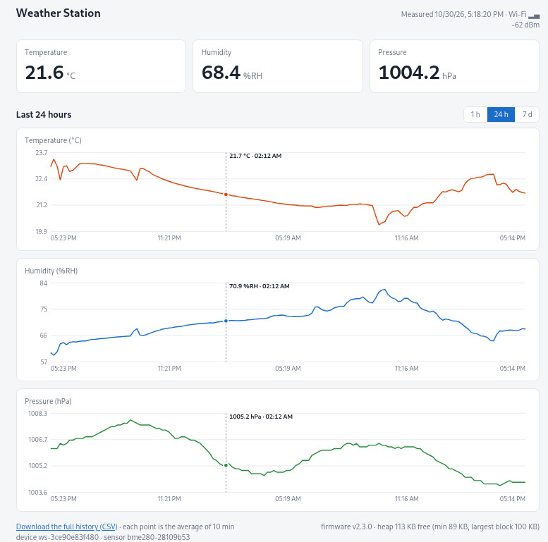

# ESP32 Weather Station

An ESP32 weather station that reads **temperature**, **humidity** and **air pressure** from a BME280 sensor and shows the values in real time on the 0.96" SSD1306 OLED display built into the ideaspark ESP32 development board. The date and time are fetched over Wi-Fi from an NTP server, the readings can be sent to an MQTT broker, a history of the readings is kept in the internal flash, and a web page shows everything on the local network.

Written in C++ with **ESP-IDF v6.1** and **FreeRTOS**. The BME280 and SSD1306 drivers are implemented directly on top of the ESP-IDF I2C driver; the only external component is Espressif's MQTT client (`espressif/mqtt`), which the build downloads automatically from the ESP Component Registry.

<p align="center">
  
  &nbsp;&nbsp;
  
</p>
<p align="center"><em>The station with the BME280 wired to the board (left) and its web page in a browser, 24-hour view (right).</em></p>

What the OLED display shows (128x64):

```
+--------------------------------+
| *   15/10/2026 14:32      ((o  |  <- yellow band: measurement dot, date/time, Wi-Fi icon
+--------------------------------+
| TEMP              23.4  oC     |
| HUM               56.1  %RH    |
| PRES            1012.8  hPa    |
+--------------------------------+
```

The dot at the left lights up for 0.5 s each time a new measurement arrives. The Wi-Fi icon shows 1 to 3 arcs according to the signal strength and an X while disconnected. Before the clock is synchronized, the header shows "WEATHER STATION".

## Display on/off (energy saving)

The **BOOT** button of the board switches the display off and on. The display also switches off by itself after 5 minutes without a button press; pressing the button wakes it up. The time is set in `idf.py menuconfig` ("Display switch-off after inactivity", 0 = never). While the display is off, the station keeps measuring, logging and publishing.

In the serial monitor: `display on`, `display off`, `display status`.

The red **PWR** LED is wired straight to the 3.3 V supply and cannot be switched off by the firmware.

## Hardware

| Component | Description |
|---|---|
| Board | ideaspark ESP32 development board with built-in 0.96" SSD1306 OLED (128x64, I2C) |
| Module | ESP-WROOM-32 (ESP32, Wi-Fi + Bluetooth) |
| Sensor | BME280 (temperature, humidity, pressure), I2C |
| Power supply | 3.3 V |

### Wiring

The BME280 shares the I2C bus with the board's display:

| BME280 | ESP32 |
|---|---|
| VCC | 3V3 |
| GND | GND |
| SDA | GPIO 21 |
| SCL | GPIO 22 |

Default I2C addresses: BME280 at `0x76` (SDO to GND; use `0x77` if SDO is tied to VCC) and SSD1306 at `0x3C`. The full board pinout is in [pinout.png](pinout.png).

The board's blue LED (GPIO 2) blinks when the system enters error mode.

## Building and flashing

Prerequisite: [ESP-IDF v6.1](https://docs.espressif.com/projects/esp-idf/) installed.

```bash
# 1. Activate the ESP-IDF environment
source ~/.espressif/tools/activate_idf_v6.1.sh

# 2. Set the target (first time only)
idf.py set-target esp32
# 3. Set the Wi-Fi credentials and, optionally, the station name, the measurement
#    interval, the MQTT broker and the history interval (first time only):
#    "Weather Station" menu
idf.py menuconfig

# 4. Build
idf.py build

# 5. Flash and open the serial monitor (adjust the port)
idf.py -p /dev/ttyUSB0 flash monitor
```

The serial monitor runs at 115200 baud and prints the readings, for example:

```
I (1234) weather: 2026-10-15 14:32:05  T=23.41 C  H=56.12 %RH  P=1012.84 hPa  Alt~3 m
```

The timestamp appears once the clock has been synchronized via NTP. The Wi-Fi credentials are stored only in the local `sdkconfig`, which is not committed. With no SSID configured, the station works normally without the date and time.

> **VS Code with the ESP-IDF extension:** turn off the setting `idf.enableUpdateSrcsToCMakeListsFile`. When it is on, the extension inserts every new `.c`/`.cpp` file into the nearest `CMakeLists.txt`, including the files of the downloaded MQTT component, and the build fails.

## Identification

Every station and every sensor has an identifier, so a management system can tell them apart and keep the data of several stations together:

- **Device:** `ws-` followed by the board's MAC address, for example `ws-a0b76551a842`. It never changes, not even after reflashing.
- **Sensor:** the type followed by a checksum of the chip's factory calibration data, for example `bme280-3fa91c07`. The BME280 has no serial number, but its calibration data differ from chip to chip, so a replaced sensor gets a new identifier; the station notices the replacement and logs it (`Sensor at position 0 (i2c@0x76) replaced: ...`).
- **Name (optional):** a free-text name such as "Varanda", set in menuconfig ("Station name"). It is shown on the web page and in `sys`, but never used as a key.

The identifiers appear in the boot log, in `sys`, on the web page, in every MQTT message and in every line of the history CSV.

## Sending data via MQTT

With a broker URI set in menuconfig (for example `mqtt://192.168.1.10:1883`), the station publishes the latest reading every 60 s (configurable) to its own topic `weather-station/<device_id>/data`, as JSON with QoS 1 (the broker confirms each message; unconfirmed ones are sent again after a reconnection) and the retain flag:

```json
{"device_id":"ws-a0b76551a842","sensor_id":"bme280-3fa91c07","time":1792161125,"temperature_c":23.41,"humidity_rh":56.12,"pressure_hpa":1012.84,"rssi_dbm":-67}
```

`time` is the Unix time of the reading and appears once the clock has been synchronized. `rssi_dbm` is the weakest Wi-Fi signal measured since the previous message (sampled with every measurement), so a consumer can follow the quality of the link over time; it is not stored in the flash history. On every connection, and after a sensor replacement, the station also publishes a retained message to `weather-station/<device_id>/info` with its name, firmware version, intervals and sensors (with channels, units and resolution); a management system finds all stations by subscribing to `weather-station/+/info`. The topic `weather-station/<device_id>/status` says whether the station is reachable: `online` while it is connected, and `offline`, which the broker publishes by itself about 90 s after the station stops answering (MQTT last will). To watch everything: `mosquitto_sub -h 192.168.1.10 -t 'weather-station/#' -v`. With an empty URI, or without Wi-Fi, nothing is sent; broker failures never stop the station.

> **Updating from v1.x:** up to v1.9.1 the readings went to `weather-station/data`, without identifiers. Subscribers must move to `weather-station/<device_id>/data` (or `weather-station/+/data`). The station clears the old retained message on that topic.

## Web page

Once Wi-Fi is connected, the station serves a page on the local network. Its address appears in the serial monitor:

```
I (5321) web: Web page at http://192.168.1.42/
```

The page shows the current values (refreshed at every measurement) and charts from the flash history over the last hour, 24 hours or 7 days (buttons above the charts), and has a link to download the whole history as CSV. Each point of a chart is an average: of 1 minute over 1 hour (60 points), of 15 minutes over 24 hours (96 points) and of 2 hours over 7 days (84 points); few points keep the answer small, which matters on a weak Wi-Fi link. The station keeps the chart data of the three periods ready in RAM, updated at every measurement, so it answers in a few milliseconds whatever the measurement interval; the page loads all three periods when it opens, so switching between them is instant, and then only adds the new measurements, so it stays light even when left open; after the page was in the background (or the computer asleep) it reloads the data, so the lines stay continuous; the CSV keeps every single measurement. Point at a chart with the mouse (or touch it on a phone) to see the time and the values of that moment in all three charts at once. At the top right, the status line ends with the Wi-Fi signal bars, and the line below shows the signal in dBm (for example `-67 dBm`), refreshed at every measurement, which helps to find a good place for the station. The footer shows, on the right of the CSV download link, the firmware version and the heap memory (free now, lowest since the start, largest free block), the same figures as `sys`, so the station can be checked without the serial console. It needs no internet access and works on phones. Tip: reserve the station's IP in your router (DHCP reservation) so the address does not change.

| Address | Content |
|---|---|
| `/` | the page |
| `/api/current` | current values, identifiers, Wi-Fi signal (`rssi_dbm`), firmware version and heap as JSON |
| `/api/info` | device, firmware, intervals and sensors as JSON (same as the MQTT info message) |
| `/api/charts` | the three chart periods of the page (1 h, 24 h, 7 d) in one answer, as JSON |
| `/api/history?hours=24&points=96` | history of the last N hours as JSON, averaged into P points (defaults: 24 hours; the chart's number of points for 1, 24 and 168 hours, else 150) |
| `/history.csv` | the whole history as CSV, named `history-<device_id>.csv` (see below) |

**Downloading the CSV:** the station sends the file gzip-compressed (about 5 times less data over Wi-Fi) to clients that ask for it, and they unpack it while saving, so the saved file is always the plain CSV. Browsers do this by themselves. With curl, `--compressed` asks for the compressed transfer and unpacks it; without it the file comes uncompressed, with the same content:

```bash
curl --compressed -o history.csv http://<ip>/history.csv   # faster
curl -OJ --compressed http://<ip>/history.csv              # keeps the name history-<device_id>.csv
```

The page has no password and is read-only; anyone on the local network can see it. While the full CSV is downloading, the page pauses its updates (the server handles one request at a time).

## Measurement history

Every 60 s (configurable) the latest reading is stored in the `history` partition of the internal flash (5 MB, about 325,000 readings, roughly 7.4 months at 60 s). When it is full, the oldest readings are overwritten. The history survives restarts and power loss. Each stored reading names the device and the sensor that took it.

It is read in the serial monitor (`idf.py monitor`), at the `weather> ` prompt:

| Command | What it does |
|---|---|
| `log info` | number of stored readings, space used, device and sensor |
| `log dump 100` | the last 100 readings as CSV (`log dump` alone prints everything, which takes a while at 115200 baud) |
| `log clear` | erases the history |
| `help` | lists the commands |

```
device_id,sensor_id,seq,time,temperature_c,humidity_rh,pressure_hpa
ws-a0b76551a842,bme280-3fa91c07,1520,2026-10-16 14:31:00,23.41,56.12,1012.8
ws-a0b76551a842,bme280-3fa91c07,1521,2026-10-16 14:32:00,23.44,56.05,1012.8
# 2 records
```

To save the CSV on the PC, press `Ctrl+T` then `Ctrl+L` in the monitor before `log dump`: the output is saved to a log file in the current directory until the shortcut is pressed again.

> **Updating from v1.x: download the history first.** v2.0.0 stores the history in a new format and does not read the old one: download `/history.csv` (or `log dump`) before flashing v2.0.0. The old data are ignored and overwritten as new readings arrive. Going back to a v1.x firmware afterwards needs `log clear`.

> **Updating from v1.5.0 or earlier:** v1.6.0 uses its own partition table (`partitions.csv`). New checkouts get it from `sdkconfig.defaults`; in an existing local `sdkconfig`, choose it in `idf.py menuconfig` → "Partition Table" → "Custom partition table CSV" (file `partitions.csv`). `idf.py flash` writes the new table; the Wi-Fi settings are not lost.

## Troubleshooting

**Wi-Fi signal first.** The web page needs a signal of about −60 dBm or better (`sys` shows it, and the `health:` log line every 10 minutes). Around −65 to −75 dBm the link loses packets: the page and its charts can take seconds or stall. Move the station (or a mesh node) closer and keep the end of the ESP32 module, where the antenna is, free of cables and metal. An answer that takes a second or more is logged, for example `W (...) web: Slow answer: /api/charts, 16384 bytes in 3.2 s`; many of them mean a lossy link. `ping` from a computer to the station shows it too: more than a few percent packet loss is too much. Close the web page while downloading the full CSV: the server answers one request at a time, and the page's requests wait (and fail with `error in send : 104` in the log) until the download ends. Every Wi-Fi connection is logged with the access point, channel, channel width, security and signal, for example `Associated with "IoT" (ca:06:c3:51:a8:42), channel 6 HT20, WPA2, -57 dBm`, and every disconnection with the access point and the meaning of the reason, for example `Wi-Fi disconnected from "IoT" (ca:06:c3:51:a8:42, -61 dBm): reason 2, access point did not answer authentication`.

In the serial monitor, `sys` shows the uptime, why the station last started, the free memory, the device and sensor identifiers and the firmware version, the Wi-Fi link (signal, IP, gateway), the network watchdog (last sign of traffic and where it came from), the MQTT state and how many web requests were served. Every 10 minutes the same figures appear in the log as a `health:` line.

If Wi-Fi stays associated but no traffic gets through, the station notices it within about 3 minutes (every minute it looks for MQTT or web traffic, and pings the router only when there is none), reconnects Wi-Fi, and after two reconnections without success restarts itself. The history in flash is kept. After a restart, the first log lines show the reason (`health: Started by: software restart`).

The MQTT client ID is the device identifier (`ws-` followed by the board's MAC address); it appears in the `Connected to MQTT broker ... as "..."` log line and in `sys`, which helps to find the station in the broker's log.

## Configuration

The station name, the measurement interval (1 to 3600 s, default 2 s), the Wi-Fi credentials, and the MQTT broker URI, user, password and publish interval (1 to 86400 s, default 60 s), the history log interval (1 to 86400 s, default 60 s), and the display switch-off after inactivity (0 to 1440 min, default 5 min) are set with `idf.py menuconfig` in the "Weather Station" menu.

All other tunable parameters live in [main/config.h](main/config.h):

- I2C pins, frequency and port;
- BME280 and SSD1306 addresses;
- display size (128x64 or 128x32), contrast and yellow band;
- sea-level pressure used for the altitude estimate;
- task periods, stack sizes and priorities;
- NTP server, time zone (default UTC-3), Wi-Fi retry interval and signal icon thresholds;
- MQTT topic prefix, QoS, retain flag and reconnect interval;
- Wi-Fi power save (off by default: some routers stop delivering packets to a sleeping ESP32);
- history partition label and console prompt;
- web server port, chart window, maximum points and connections.

The flash layout is in [partitions.csv](partitions.csv).

## Architecture

The firmware runs five FreeRTOS tasks, plus the serial console:

- **`taskMeasure`**: reads the BME280 at the measurement interval (2 s by default).
- **`taskDisplay`**: refreshes the display every 1 s, and right away when a new measurement arrives, with a measurement dot, the date and time and a Wi-Fi signal icon in the header.
- **`taskPublish`**: sends the latest reading to the MQTT broker at the publish interval (60 s by default), only when the broker is configured.
- **`taskLog`**: stores the latest reading in the flash history at the log interval (60 s by default).
- **`taskHealth`**: pings the router every minute and recovers a stuck network, and logs a health line every 10 minutes.

The HTTP server (`web_server`) runs in its own ESP-IDF task once Wi-Fi has an IP address.

Wi-Fi and NTP run in the background (`net_time`), as does the MQTT client (`telemetry`); all of them reconnect on their own and network failures never stop the station. The MQTT client waits while Wi-Fi is down and reconnects as soon as Wi-Fi is back.

The `i2cMutex` mutex controls access to the I2C bus, and `dataMutex` protects the data shared between the tasks. After 3 consecutive failures, the device is re-initialized automatically. If the display or the sensor fails to start at boot, the system halts and signals the error through the LED and the serial console.

```
main/
├── main.cpp      # app_main, initialization and FreeRTOS tasks
├── config.h      # central configuration
├── bme280.*      # BME280 driver (Bosch compensation formulas)
├── ssd1306.*     # SSD1306 driver with a local frame buffer
├── font5x7.h     # 5x7 font (ASCII + degree sign)
├── net_time.*    # Wi-Fi station + NTP time of day
├── telemetry.*   # MQTT client, JSON payload
├── history.*     # measurement history in flash + `log` console command
├── web_server.*  # HTTP server: page, JSON and CSV
├── health.*      # health log, `sys` command, network watchdog
├── identity.*    # device and sensor identifiers, station name
├── gzip_stream.* # compact gzip compressor for the CSV download
├── charts.*      # chart tables (1 h / 24 h / 7 d) kept in RAM for the web page
├── web_page.html # the web page, embedded in the firmware
├── idf_component.yml  # external component: espressif/mqtt
└── Kconfig.projbuild  # menuconfig menu: name, intervals, Wi-Fi, MQTT broker
partitions.csv    # flash layout: nvs, phy_init, factory app (2 MB), history (5 MB)
```

The full functional specification is in [esp32-weather-station.md](esp32-weather-station.md).

## Roadmap

- Sensor calibration
- Hardware RTC module so the time survives power loss without Wi-Fi
- A second sensor (the history format and the identifiers already allow it)
